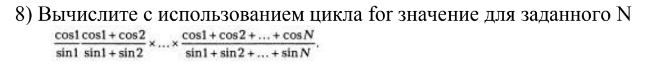
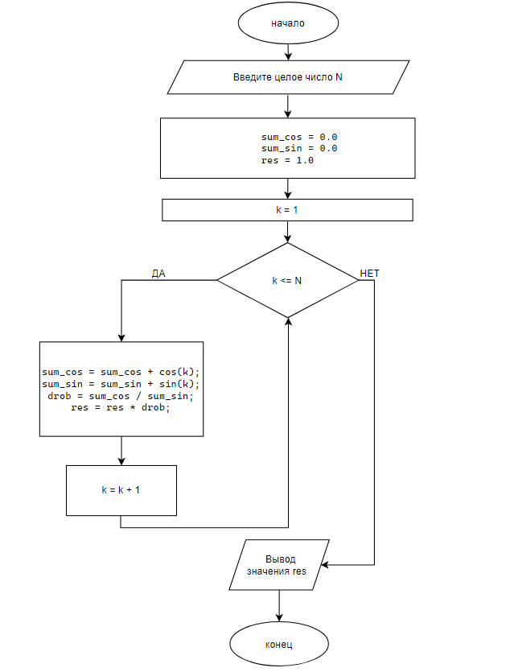

# Домашнее задание к lab8
### вариант 8
### Задача


### Решение

```
#define _CRT_SECURE_NO_DEPRECATE
#include <locale.h>
#include <stdio.h>
#include <math.h>
int main() 
{
    setlocale(LC_ALL, "ru_RU.UTF-8");
    int N, k;
    printf("Введите целое число N: ");
    scanf("%d", &N);
    double sum_cos = 0.0;
    double sum_sin = 0.0;
    double res = 1.0;
    for (k = 1; k <= N; k++)
    {
        sum_cos = sum_cos + cos(k);
        sum_sin = sum_sin + sin(k);
        double drob = sum_cos / sum_sin;
        res = res * drob;
    }
    printf("Результат: %lf\n", res);
}
```
### Блок схема 


### Вывод
В ходе работы была разработана программа для вычисления заданного произведения сумм синусов и косинусов. Вычисления реализованы с помощью цикла for и накопительных переменных, условный оператор не использовался.
